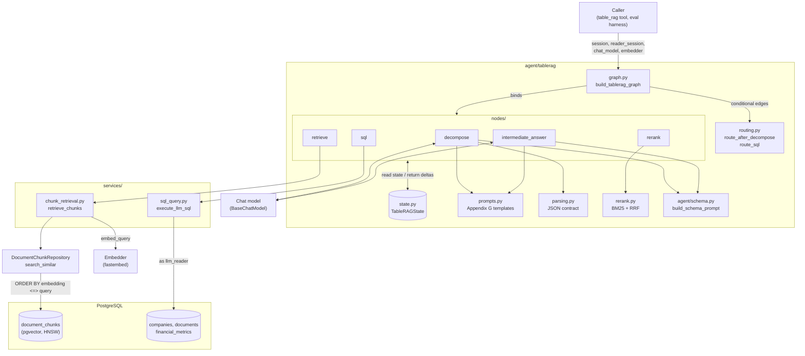
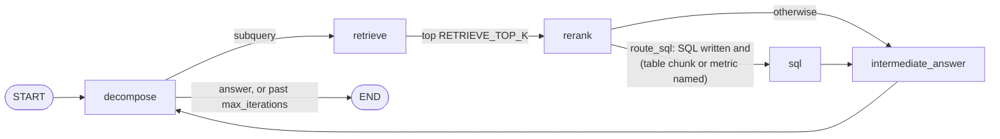
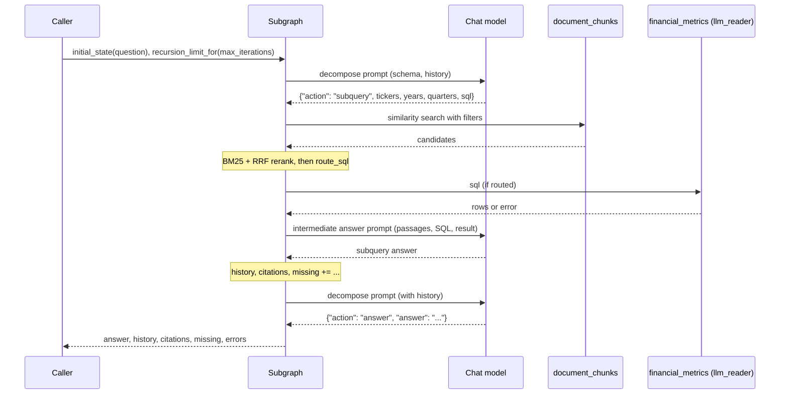

# Financial Data Agent - TableRAG

## 1. Components
`agent/tablerag/graph.py` `build_tablerag_graph(session, reader_session, chat_model, embedder)` compiles the subgraph. The caller constructs every backend and injects it; the graph never builds one. Each node is a module-level function in `agent/tablerag/nodes/`, bound to its backends with `functools.partial`.

- **Two sessions.** `retrieve` searches chunks on the main session, because `document_chunks` is not granted to `llm_reader`. `sql` runs model-generated SQL on the `llm_reader` session only.
- **Provider seam.** Nodes see only `BaseChatModel` and the `Embedder` Protocol. No module in `agent/` imports a provider package.

## 2. Control Flow

| Node | Reads | Writes | Model call |
| --- | --- | --- | --- |
| `decompose` | `question`, `history`, `iteration` | `current`, `iteration + 1`, clears `sql_result`/`sql_error`; or `answer` | yes |
| `retrieve` | `current` (subquery, filters) | `candidates` | no |
| `rerank` | `current`, `candidates` | `reranked` (top `RERANK_TOP_K`) | no |
| `sql` | `current.sql` | `sql_result`, or `sql_error` and `errors` | no |
| `intermediate_answer` | `current`, `reranked`, `candidates`, `sql_result`, `sql_error` | `history`, `citations`, `missing` | yes |

With `MAX_ITERATIONS = 2` a question costs at most five model calls: two per subquery, plus the final decompose. Folding SQL generation into decompose is what keeps it at five; the paper's separate NL2SQL call would make it seven.

## 3. One Question, End to End

## 4. Contracts and Bounds
- **Decompose reply.** Exactly one JSON object, fenced or bare: `{"action": "subquery", "subquery", "tickers", "years", "quarters", "sql": "..." | null}` or `{"action": "answer", "answer": "..."}`. Anything else raises `DecompositionParseError`; there is no retry, because a retry spends the daily request budget.
- **State updates.** Nodes return deltas. `history` and `errors` append; `citations` and `missing` append only unseen items.
- **Step bound.** Every invoke passes `recursion_limit_for(max_iterations)` = `5 * max_iterations + 2`. If the model still asks for a subquery past `max_iterations`, the graph ends with `answer = None`.
- **SQL errors** are recorded, not raised, so the intermediate answer falls back to the passages.
- **Missing filings.** A fully named `(ticker, year, quarter)` absent from the candidates, when SQL returned no rows, is reported in `missing`. The subgraph never acquires; the chat agent decides whether to call `acquire_filing`.
