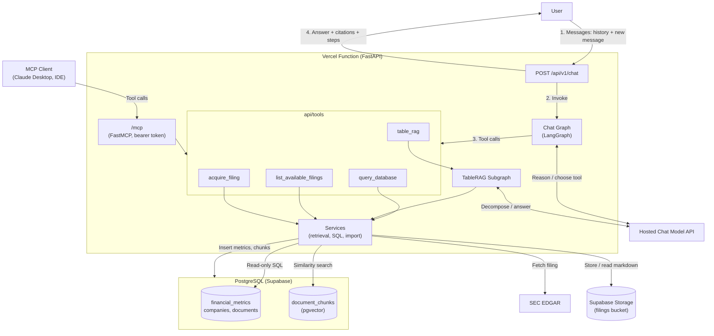
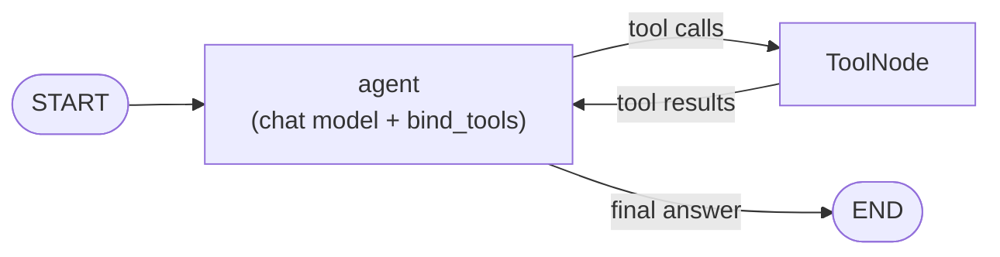
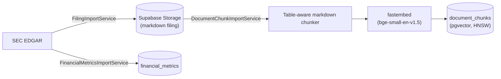
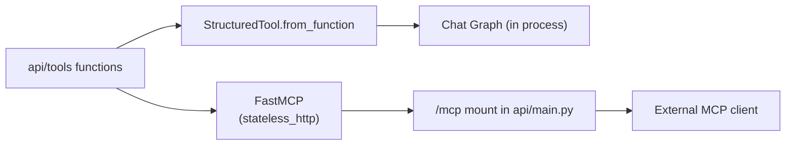

# Financial Data Agent - Architecture

## 1. Overview
Financial Data Agent is an AI-powered assistant for analysing earnings reports for companies in the S&P 500.

A user asks questions in natural language over a multi-turn conversation. The browser keeps the conversation and sends prior turns with each message; the server stores nothing. A chat agent answers follow-ups from that history and calls tools when it needs data:
- `query_database` runs one read-only SQL query for direct metric lookups.
- `table_rag` answers grounded questions from structured metrics (SQL) and filing text (pgvector), following TableRAG (arXiv 2506.10380).
- `list_available_filings` reports which filings are already ingested.
- `acquire_filing` fetches a missing filing from SEC EDGAR and ingests it.

The same tools are exposed to external clients over MCP.

Primary use cases include:
- Financial metric lookup
- Earnings analysis
- Company comparisons
- Research question answering

## 2. High-level Architecture

Dependencies are one-way: `api/v1` and `api/tools` → `agent` → `services` → `db/repositories` → `db/models`, with `ingestion/` for external I/O. `agent/` never imports `api/`; routes and tools construct the graphs and inject the chat model, embedder and session.

## 3. Chat Agent
The chat agent is a LangGraph `StateGraph` over `MessagesState` in `agent/chat_graph.py`. The `agent` node is the chat model with the tools bound via `bind_tools`; `tools_condition` routes to a `ToolNode` while the model emits tool calls and to `END` once it answers.

- **Step bound.** `recursion_limit` is the hard cap on graph steps. A run that hits it raises instead of spinning.
- **Acquisition budget.** A counter in chat state caps SEC round-trips per request. The `acquire_filing` wrapper checks it and returns a refusal message to the model once it is spent.
- **Follow-ups.** Prior turns arrive in the request and are replayed as messages, so the model answers from history without a tool call when the answer is already in context.
- **Chat model seam.** The graph accepts a langchain-core `BaseChatModel`. `ingestion/llm.py` `build_chat_model()` constructs it from `LLM_PROVIDER` and `LLM_MODEL` (required, no default) and imports the provider package inside the branch that needs it.

## 4. TableRAG Tool
`table_rag` runs the TableRAG loop as a LangGraph subgraph in `agent/tablerag/`. It is the grounded-answer path; the chat agent decides when to use it.

### 4.1 Offline construction

### 4.2 Online loop
Decompose → retrieve → rerank → (SQL) → intermediate answer, repeated per subquery. The schema is fixed (`financial_metrics` joined to `documents` and `companies`) and fits in the prompt, so there is no per-document schema extraction; chunk metadata `(ticker, year, quarter)` supplies the filters. When retrieval and SQL both come back empty, the subgraph reports the gap and the chat agent decides whether to acquire.

Components, control flow, state and bounds: [RAG.md](RAG.md).

## 5. Tools and MCP
Tools live in `api/tools/`. Like `api/v1` routes, they are thin: they call services and translate service exceptions into tool errors.

| Tool | Backed by | Reads / writes |
| --- | --- | --- |
| `query_database(sql)` | `services/sql_query.py` as `llm_reader` | Supabase metrics (SQL); how it differs from TableRAG's SQL: [RAG.md §5](RAG.md#5-sql-in-tablerag-vs-query_database) |
| `table_rag(question, tickers?, years?, quarters?)` | TableRAG subgraph → `services/chunk_retrieval.py`, `services/sql_query.py` | Supabase metrics (SQL) and chunks (pgvector) |
| `list_available_filings(ticker?)` | `DocumentRepository` | Supabase `documents` and chunk counts |
| `acquire_filing(ticker, reporting_year, reporting_quarter)` | `FilingImportService`, `FinancialMetricsImportService`, `DocumentChunkImportService` | SEC → Supabase Storage → Postgres; re-chunks from the stored blob when the filing exists but has no chunks |

The agent never reads raw blobs. Chunks are the retrievable form of a filing, and `DocumentChunkImportService` reads the blob through `DataStorage.read_text`.

The same functions are registered twice:

- **In process.** The chat graph binds the functions directly and receives the request's session. There is no MCP hop for the app's own agent.
- **Over MCP.** `api/tools/mcp_server.py` registers the functions on a `FastMCP` server with `stateless_http=True`, mounted at `/mcp` via `streamable_http_app()`. Each call opens its own session from `get_session_factory()`. The FastAPI `lifespan` must run `mcp.session_manager.run()`; without it the mount fails on the first request.
- **Auth.** `/mcp` is on the Vercel Function's public URL. Requests must carry a bearer token matching `MCP_API_KEY`. `acquire_filing` is a write path and is never exposed without it.
- **Rejected: a separate MCP deployment.** It adds a second Vercel project, a network hop and inter-app auth, with no scaling benefit.

## 6. Conversation State
The server is stateless. The demo is a public page with no login, so there is no conversation to resume; the browser holds the conversation in memory and a refresh starts over.

- `POST /api/v1/chat` — `{messages: [{role: "user" | "assistant", content}]}` → `{answer, citations, steps, usage}`. The last message must be from the user; the history is capped at `CHAT_HISTORY_LIMIT` messages with a per-message length cap, and anything else is rejected with 422.
- Only user messages and final answers are sent back. Tool calls are not replayed, so context stays bounded.
- The client can forge assistant turns. The tools are bounded by `llm_reader`, the acquisition budget and `recursion_limit`, not by trusting history.
- **Rejected: a server-side conversation store.** With no login it resumes nothing, and it adds tables, RLS and retained user messages.
- **Rejected: `langgraph-checkpoint-postgres`.** It creates its own tables outside Alembic, the same reason `langchain-postgres` was rejected for the vector store.

## 7. Deployment
Everything runs in the existing single Vercel Function (Hobby: 2 GB / 1 vCPU, 300 s per request), see [deployment.md](deployment.md). No new resource is added.

- **Embeddings** run in process with `fastembed` on onnxruntime, for both ingestion and queries.
- **The chat model is an external hosted API** with a free tier, called over HTTPS. It is not self-hosted — a chat model does not fit the function's CPU and memory, and CPU inference is too slow for the multi-step TableRAG loop. Azure AI Foundry and Azure OpenAI are not used. It is the Gemini API free tier; the provider must support tool calling, and the evaluation harness chooses the model.
- **Secrets** follow the existing Terraform `secrets` / `secret_env_vars` pattern: `database-url`, the LLM API key and `MCP_API_KEY`. `LLM_PROVIDER` and `LLM_MODEL` are plain `env_vars`. The container-app module is unchanged.
- **Privacy.** Free tiers may use prompts for training. Filings are public; user messages are not. The chosen tier's data terms are part of the provider decision.
