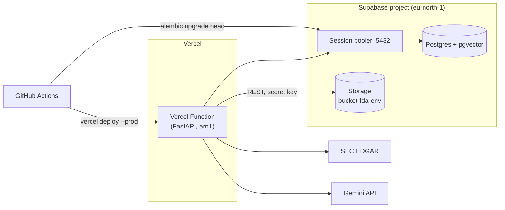
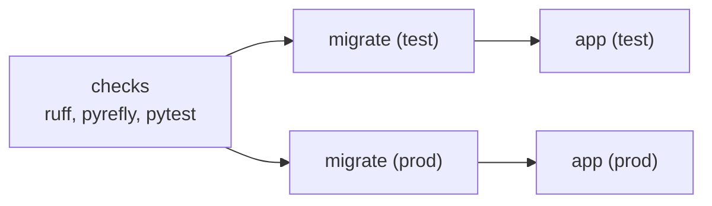

# Financial Data Agent - Deployment

How `test` and `prod` run on Vercel and Supabase. The Azure stack in `iac/` is retired and kept for reference only; see [infrastructure.md](infrastructure.md).

## 1. Overview

| Concern | Service | Owned by |
| --- | --- | --- |
| API (FastAPI, whole app) | Vercel Function, Hobby plan, projects `fda-test` and `fda-prod` | `vercel.json`, `[tool.vercel]` in `pyproject.toml`, the pipeline |
| Filings (markdown, S&P 500 parquet) | Supabase Storage, private bucket `bucket-fda-<env>` | `SupabaseDataStorage` in `ingestion/storage.py` |
| Postgres + pgvector | The existing Supabase projects `fda-test` and `fda-prod` | `migrations/versions/` |

There is no Terraform, so there is no state backend, which was the last thing tying the project to Azure. The pipeline creates each Vercel project on its first deploy and passes all runtime configuration with every deploy (section 3). Only the Supabase buckets and the credentials are created by hand (section 2).



## 2. Manual setup

1. **Supabase Storage**, in each project:
   - create a **private** bucket `bucket-fda-<env>`;
   - under *Project Settings* → *API Keys*, create or reuse a **secret** key (`sb_secret_...`). It bypasses row level security, so it only ever lives in GitHub and on the deployment.
2. **Vercel token**, once: create it under *Account Settings* → *Tokens*, scoped to your account. When it expires, every deploy fails at the link step, so note its expiry date.
3. **GitHub environments** `test` and `prod`: add the secrets and variables in section 3.

Nothing is created in the Vercel dashboard. `Deploy app` runs `vercel link --yes --project fda-<env>`, which creates the project the first time and links to it afterwards. `vercel.json` fixes the framework (`fastapi`) and the region. It also sets `git.deploymentEnabled: false`, so even a later Git connection cannot deploy ahead of the migration. A project that was already created in the dashboard is simply reused.

The region is `arn1` (Stockholm), next to the Supabase region `eu-north-1`. Every request makes several pooler round trips, so the default `iad1` would add transatlantic latency to each.

## 3. Configuration

Every value lives in the GitHub environment. `Deploy app` passes each one as a runtime env var with `vercel deploy --env`. Vercel project settings hold none of them, so they cannot drift from GitHub. To change a value, update it in GitHub and redeploy. Values set in the Vercel dashboard are overridden by these.

| GitHub name | Kind | Becomes / used by |
| --- | --- | --- |
| `VERCEL_TOKEN` | secret | CLI authentication in `Deploy app` |
| `DATABASE_URL` | secret | `DATABASE_URL`; also `Migrate database` |
| `LLM_READER_DATABASE_URL` | secret | `LLM_READER_DATABASE_URL`; also `Migrate database` |
| `SUPABASE_URL` | secret | `SUPABASE_URL`, i.e. `https://<project_ref>.supabase.co` |
| `SUPABASE_SECRET_KEY` | secret | `SUPABASE_SECRET_KEY` |
| `GOOGLE_API_KEY` | secret | `GOOGLE_API_KEY` |
| `LLM_MODEL` | variable | `LLM_MODEL` |
| `FILINGS_BUCKET` | variable | `FILINGS_BUCKET`, i.e. `bucket-fda-<env>` |

The workflow sets these values itself:

| Variable | Value |
| --- | --- |
| `ENVIRONMENT` | `test` or `prod`. Anything but `local` selects Supabase Storage. |
| `EMBEDDING_MODEL` | `BAAI/bge-small-en-v1.5` |
| `EMBEDDING_CACHE_DIR` | `/tmp/fastembed` |
| `EDGAR_LOCAL_DATA_DIR` | `/tmp/edgar` |

The function's filesystem is read-only except `/tmp`, which is why the embedding model and the edgartools cache are pointed there. The model is downloaded on the first embedding call of each new instance.

Build the database URLs from the dashboard's *Connect* → *Session pooler* string:

1. Replace the scheme with `postgresql+psycopg://`.
2. Insert the password.
3. Append `?sslmode=require`.

For `LLM_READER_DATABASE_URL`, use user `llm_reader.<project_ref>` and the `llm_reader` password. Keep passwords to `A-Z a-z 0-9 - _ . ~` so they need no percent-encoding. [database.md](database.md#5-the-connection-string) explains why it must be the session pooler on port 5432.

The Azure and Terraform secrets (`AZURE_*`, `SUPABASE_ACCESS_TOKEN`, `SUPABASE_DB_PASSWORD`, `LLM_READER_DB_PASSWORD`) are no longer read by any workflow.

## 4. Smoke check

The smoke check requests `/api/v1/cow` on the URL that `vercel deploy` printed, not on the production domain. That domain is only known once the project exists, and it gets a suffix if `fda-<env>.vercel.app` is already taken. Vercel's standard deployment protection puts per-deployment URLs behind a login. The check therefore uses `vercel curl`, which adds a protection-bypass token; the CLI creates the token in the project's settings on first use.

## 5. Bundle size

Python functions are limited to 500 MB uncompressed. Measured from the Linux wheels in `uv.lock`:

| Set | Compressed wheels | Unpacked (approx.) |
| --- | --- | --- |
| All runtime dependencies | ~200 MB | ~600–700 MB |
| Chat path only (no ingestion) | ~67 MB | ~200 MB, plus ~67 MB model in `/tmp` |

The largest packages are `polars-runtime` (57 MB), `pyarrow` (50 MB, via `edgartools`) and `onnxruntime` (24 MB). Only the ingestion routes need polars and pyarrow.

The whole app is deployed anyway, using Vercel's **Large Functions** beta, which allows bundles up to 5 GB on Fluid compute. New projects are eligible by default, and the pipeline creates the projects, so nothing needs setting. If a build is ever refused on size, run `vercel env add VERCEL_SUPPORT_LARGE_FUNCTIONS production` with value `1` to opt in explicitly. `.vercelignore` keeps `data/`, `docs/`, `papers/`, `graphify-out/`, `iac/` and `tests/` out of the upload.

If Large Functions is withdrawn or refused on Hobby:

1. Move `edgartools`, `polars` and `langchain-text-splitters` into a uv dependency group. Vercel installs only `[project].dependencies`.
2. Point `[tool.vercel] entrypoint` at an app that registers only the chat and health routers.
3. Run imports locally with `uv run fastapi dev` against the deployed environment's variables.

The chat route imports none of the ingestion-only packages, so this split needs no other changes.

## 6. Known limits

- **300 s per request** on Hobby. A single filing import fits; the bulk backfill in `ingestion/filings.py` stays a local command.
- **Cold starts** import polars, pyarrow and edgartools, because `api/main.py` registers every router, and they download the embedding model. Expect several seconds on the first request to a new instance.
- **Pooler connections.** Each function instance keeps its own SQLAlchemy pool on the session pooler, whose pool size is small on the free tier. If concurrent instances exhaust it, move the app's URL to the transaction pooler (port 6543) with psycopg's `prepare_threshold=None`; Alembic must stay on the session pooler.
- **Hobby is for non-commercial use** under Vercel's terms.
- **Free Supabase projects pause** after 7 days of inactivity, which fails both the migration job and the app.

## 7. Deployment pipeline

`.github/workflows/deployment-pipeline.yml`:



- **checks** runs on every pull request with Python 3.12, the oldest version Vercel supports.
- **Migrate database** runs `alembic upgrade head` with `DATABASE_URL` from the environment's secrets.
- **Deploy app** has three steps:
  1. `vercel link --yes --project fda-<env>`, which creates the project on the first run.
  2. `vercel deploy --prod` with the configuration from section 3. This uploads the source and builds on Vercel from `pyproject.toml` and `uv.lock`.
  3. `vercel curl <deployment-url>/api/v1/cow`.

The app deploy is gated on its migration, so new code never reaches a database that is behind it. The `prod` GitHub environment's approval is what holds prod back.

The retired Azure workflow is kept, unexecuted, at `iac/azure-deployment-pipelines.yml`.

## 8. Moving existing filings from Azure

The bucket uses the same object names as the old `filings` blob container, so `documents.raw_document_path` stays valid once the objects are copied. This is a one-off and is only needed if the Azure container still holds filings worth keeping; otherwise re-run the imports.

```bash
az storage blob download-batch --account-name stfda<env> --source filings --destination filings-export --auth-mode login

ENVIRONMENT=<env> SUPABASE_URL=... SUPABASE_SECRET_KEY=... FILINGS_BUCKET=bucket-fda-<env> uv run python -c "
from pathlib import Path
from financial_data_agent.ingestion.storage import build_data_storage
storage = build_data_storage()
for path in Path('filings-export').rglob('*'):
    if path.is_file():
        storage.save_bytes(path.relative_to('filings-export').as_posix(), path.read_bytes())
"
```
