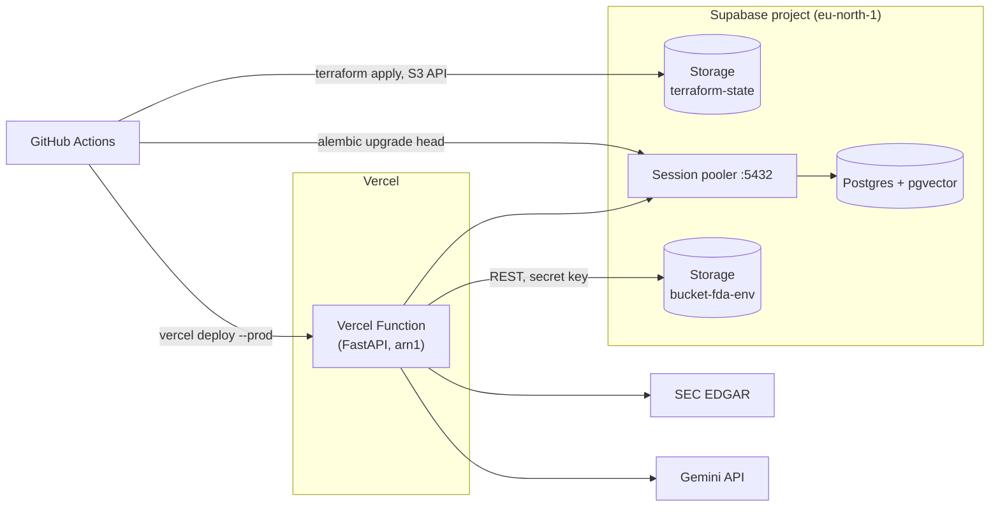

# Financial Data Agent - Deployment

How `test` and `prod` run on Vercel and Supabase. The commands live in [iac/vercel-supabase/README.md](../iac/vercel-supabase/README.md). The Azure stack is retired and kept for reference only; see [infrastructure.md](infrastructure.md).

## 1. Overview

| Concern | Service | Owned by |
| --- | --- | --- |
| API (FastAPI, whole app) | Vercel Function, Hobby plan, projects `fda-test` and `fda-prod` | Terraform (`modules/vercel-app`) creates the project and its env vars; `vercel.json` sets framework and region; the pipeline uploads the code |
| Postgres + pgvector | Supabase projects `fda-test` and `fda-prod` | Terraform (`modules/supabase-postgres`) for the project and connection strings; `migrations/versions/` for the schema |
| Filings (markdown, S&P 500 parquet) | Supabase Storage, private bucket `bucket-fda-<env>` | Created **by hand**; written by `SupabaseDataStorage` in `ingestion/storage.py` |
| Terraform state | Supabase Storage, private bucket `terraform-state`, through its S3 API | Created **by hand** |

`iac/vercel-supabase/<env>` is one Terraform root per environment. It reuses `modules/supabase-postgres` unchanged from the Azure stack, so the database URLs are composed by Terraform as before, and adds `modules/vercel-app`.



## 2. Manual setup

Neither the Supabase nor the Vercel Terraform provider can create Storage buckets, so these are made by hand, once per environment:

- **The filings bucket `bucket-fda-<env>`.** It must exist and be **private** before the first import. The app only reads and writes objects in it; nothing creates it.
- **The state bucket `terraform-state`**, also private, plus an **S3 access key** for it under *Project Settings* → *Storage* → *S3 Connection*.
- **A secret API key** (`sb_secret_...`), which the app uses for Storage.
- **A Vercel token**, shared by both environments.
- **The GitHub secrets and variable** in section 3.
- **The one-time state move** in section 5.

The steps are listed in order in [iac/vercel-supabase/README.md](../iac/vercel-supabase/README.md).

The Vercel region is pinned in `vercel.json` to `arn1` (Stockholm), next to the Supabase region `eu-north-1`. Every request makes several pooler round trips, so the default `iad1` would add transatlantic latency to each.

## 3. Configuration

GitHub environment secrets and variables, per environment:

| Name | Kind | Used for |
| --- | --- | --- |
| `SUPABASE_ACCESS_TOKEN` | secret | Supabase provider. Classic account token, see [infrastructure.md](infrastructure.md#2-prerequisites-and-secrets) |
| `SUPABASE_DB_PASSWORD` | secret | `database_password`, composed into `DATABASE_URL` |
| `LLM_READER_DB_PASSWORD` | secret | composed into `LLM_READER_DATABASE_URL` |
| `SUPABASE_SECRET_KEY` | secret | Vercel env var `SUPABASE_SECRET_KEY` |
| `GOOGLE_API_KEY` | secret | Vercel env var `GOOGLE_API_KEY` |
| `VERCEL_TOKEN` | secret | Vercel provider (`VERCEL_API_TOKEN`) and CLI |
| `TF_STATE_ACCESS_KEY_ID`, `TF_STATE_SECRET_ACCESS_KEY` | secret | State backend (`AWS_ACCESS_KEY_ID`, `AWS_SECRET_ACCESS_KEY`) |
| `TF_STATE_S3_ENDPOINT` | variable | State backend (`AWS_ENDPOINT_URL_S3`), `https://<project_ref>.storage.supabase.co/storage/v1/s3` |

The `AZURE_*` secrets are no longer read by any workflow.

Terraform sets the Vercel project's production environment variables:

| Variable | Source |
| --- | --- |
| `DATABASE_URL`, `LLM_READER_DATABASE_URL` | Composed by `modules/supabase-postgres`, sensitive |
| `SUPABASE_URL` | `https://<project_ref>.supabase.co`, from the project |
| `SUPABASE_SECRET_KEY`, `GOOGLE_API_KEY` | GitHub secrets above, sensitive |
| `ENVIRONMENT`, `EMBEDDING_MODEL`, `LLM_MODEL`, `FILINGS_BUCKET` | `terraform.tfvars` |
| `EMBEDDING_CACHE_DIR`, `EDGAR_LOCAL_DATA_DIR` | `/tmp/fastembed`, `/tmp/edgar` |
| `VERCEL_SUPPORT_LARGE_FUNCTIONS` | `1`, see section 6 |

The function's filesystem is read-only except `/tmp`, which is why the embedding model and the edgartools cache are pointed there. The model is downloaded on the first embedding call of each new instance.

Passwords stay restricted to `A-Z a-z 0-9 - _ . ~`, because the module substitutes them into the URL without percent-encoding. See [infrastructure.md](infrastructure.md#2-prerequisites-and-secrets).

## 4. Terraform state in Supabase Storage

The `s3` backend talks to Supabase Storage's S3-compatible endpoint. Each environment's state lives in that environment's own project. The backend block cannot read variables, so the endpoint and keys come from `AWS_ENDPOINT_URL_S3`, `AWS_ACCESS_KEY_ID` and `AWS_SECRET_ACCESS_KEY`. Supabase Storage is not AWS, so the block sets `use_path_style` and skips AWS's credential, account and checksum checks.

- **No lock.** Supabase Storage is not known to support the conditional writes behind `use_lockfile`. The workflow's per-environment concurrency group is what keeps two applies from overlapping. Do not run `apply` locally while a deploy is running.
- **The state holds every secret Terraform touches**: database passwords, connection strings and the API keys passed to Vercel. That is why the bucket is private and the S3 keys exist only in GitHub. Storage S3 keys bypass row level security across all buckets in the project.
- **The state lives inside the project it describes.** Deleting the project deletes its state, which is acceptable because there would be nothing left to manage.

## 5. Adopting the existing projects

`fda-test` and `fda-prod` were created by the Azure-era Terraform, and their state is in the Azure storage account. They are adopted by moving that state into the new backend with `terraform state mv`, never by `import`:

- `database_password`, `name`, `organization_id` and `region` on `supabase_project` **force replacement**.
- The Supabase API never returns the password, so an imported project has none in state. The next plan would replace it: delete the project and its data, then create an empty one.
- The moved state still carries the password Terraform set originally, so the first plan shows no changes to the project.

As a guard, `modules/supabase-postgres` sets `prevent_destroy` on the project, so any plan that would replace it fails instead. If the Azure state is ever lost, adopting by import also needs `lifecycle { ignore_changes = [database_password] }` on the project.

The roots keep the module address `module.supabase_postgres` and the same name, organization and region as `iac/environments/<env>`, so the moved state matches without edits.

## 6. Bundle size

Python functions are limited to 500 MB uncompressed. Measured from the Linux wheels in `uv.lock`:

| Set | Compressed wheels | Unpacked (approx.) |
| --- | --- | --- |
| All runtime dependencies | ~200 MB | ~600–700 MB |
| Chat path only (no ingestion) | ~67 MB | ~200 MB, plus ~67 MB model in `/tmp` |

The largest packages are `polars-runtime` (57 MB), `pyarrow` (50 MB, via `edgartools`) and `onnxruntime` (24 MB). Only the ingestion routes need polars and pyarrow.

The whole app is deployed anyway, using Vercel's **Large Functions** beta, which allows bundles up to 5 GB on Fluid compute. Terraform sets `VERCEL_SUPPORT_LARGE_FUNCTIONS=1` on the project to opt in explicitly. `.vercelignore` keeps `data/`, `docs/`, `papers/`, `graphify-out/`, `iac/` and `tests/` out of the upload.

If Large Functions is withdrawn or refused on Hobby:

1. Move `edgartools`, `polars` and `langchain-text-splitters` into a uv dependency group. Vercel installs only `[project].dependencies`.
2. Point `[tool.vercel] entrypoint` at an app that registers only the chat and health routers.
3. Run imports locally with `uv run fastapi dev` against the deployed environment's variables.

The chat route imports none of the ingestion-only packages, so this split needs no other changes.

## 7. Known limits

- **300 s per request** on Hobby. A single filing import fits; the bulk backfill in `ingestion/filings.py` stays a local command.
- **Cold starts** import polars, pyarrow and edgartools, because `api/main.py` registers every router, and they download the embedding model. Expect several seconds on the first request to a new instance.
- **Pooler connections.** Each function instance keeps its own SQLAlchemy pool on the session pooler, whose pool size is small on the free tier. If concurrent instances exhaust it, move the app's URL to the transaction pooler (port 6543) with psycopg's `prepare_threshold=None`; Alembic must stay on the session pooler.
- **Hobby is for non-commercial use** under Vercel's terms.
- **Free Supabase projects pause** after 7 days of inactivity, which fails both the deploy job and the app.

## 8. Deployment pipeline

`.github/workflows/deployment-pipeline.yml`:

The structure follows the retired Azure pipeline: per environment, an iac job, a migration job and an app job.

```text
checks ─┬─ iac (test) ── migrate (test) ── app (test)
        └─ iac (prod) ── migrate (prod) ── app (prod)
```

**checks** runs on every pull request, with Python 3.12, the oldest version Vercel supports. Its Terraform steps run `init -backend=false`, so they need no state or secrets.

**Deploy iac** runs `terraform init`, `plan` and `apply` on `iac/vercel-supabase/<env>`. It publishes the Vercel project name as a job output for the app job.

**Migrate database** runs `terraform init` and `terraform output -raw database_url` itself rather than reading a job output. Job outputs are not masked and are readable from the Actions API, so the connection strings stay inside the one job that needs them. It masks them with `::add-mask::` before writing them to `$GITHUB_ENV`, then runs `alembic upgrade head`. `terraform_wrapper` is off in this job, because the wrapper would publish Terraform's stdout as an unmasked step output.

**Deploy app** has two steps:
1. `vercel link` to the project from the iac job, then `vercel deploy --prod`. This uploads the source and builds on Vercel from `pyproject.toml` and `uv.lock`; the runtime configuration comes from the project's env vars, which Terraform set.
2. A smoke check, `vercel curl <deployment-url>/api/v1/cow`. Vercel's standard deployment protection puts per-deployment URLs behind a login, and `vercel curl` adds a bypass token, which the CLI creates in the project's settings on first use.

The app deploy is gated on its migration, so new code never reaches a database that is behind it. What holds prod back is the `prod` GitHub environment's approval, not the test smoke check: the two branches are independent once `checks` passes.

The Vercel project is not connected to Git, and `vercel.json` sets `git.deploymentEnabled: false`, so only this pipeline deploys. The retired Azure workflow is kept, unexecuted, at `iac/azure-deployment-pipelines.yml`.

## 9. Moving existing filings from Azure

The bucket uses the same object names as the old `filings` blob container, so `documents.raw_document_path` stays valid once the objects are copied. This is a one-off and is only needed if the Azure container still holds filings worth keeping; otherwise re-run the imports.

```bash
az storage blob download-batch --account-name stfda<env> --source filings --destination filings-export --auth-mode login

ENVIRONMENT=<env> SUPABASE_URL=... SUPABASE_SECRET_KEY=... FILINGS_BUCKET=bucket-fda-<env> uv run python -c "
from pathlib import Path
from financial_data_agent.ingestion.storage import build_data_storage
storage = build_data_storage()
for path in Path('filings-export').rglob('*'):
    if path.is_file():
        storage.save_bytes(path.relative_to('filings-export').as_posix(), path.read_bytes())
"
```
